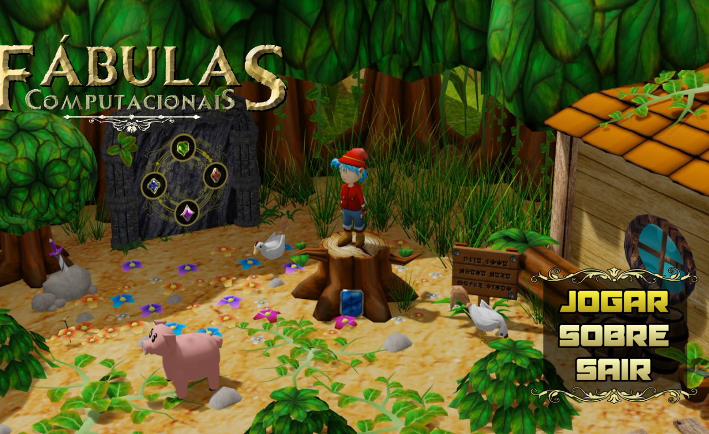
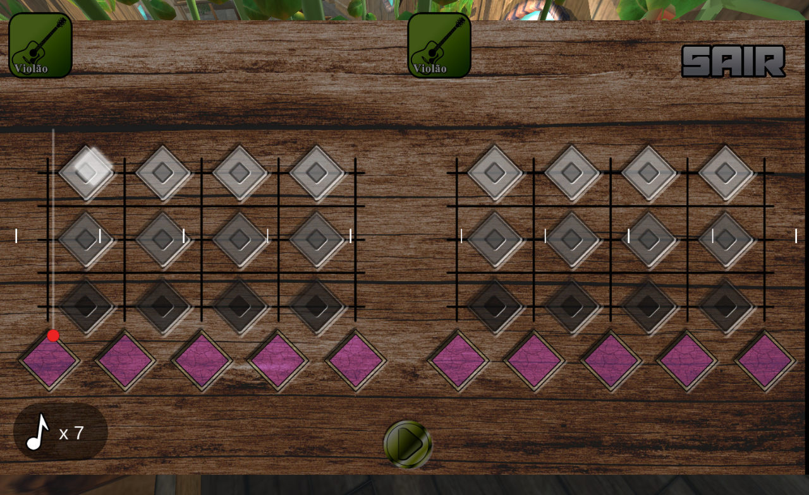
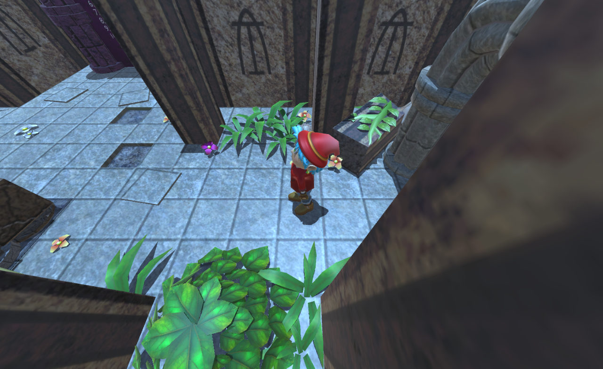
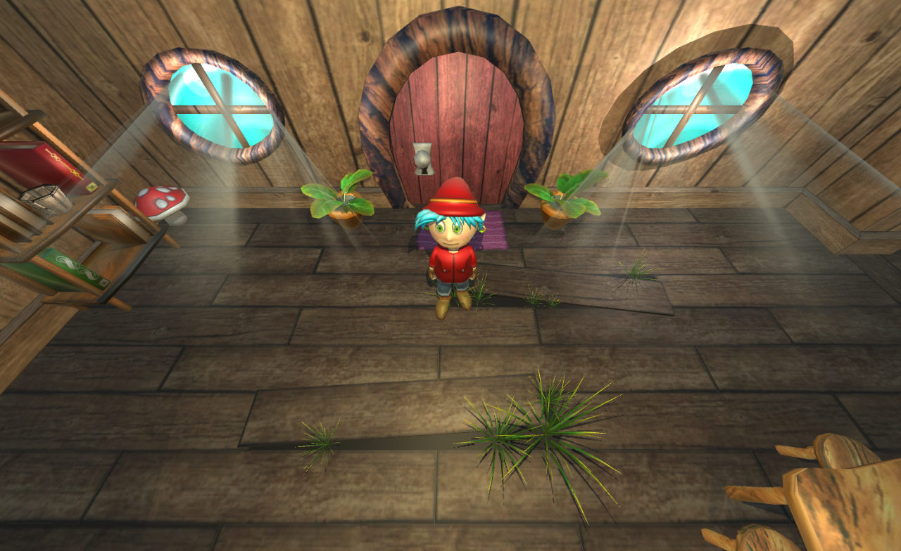
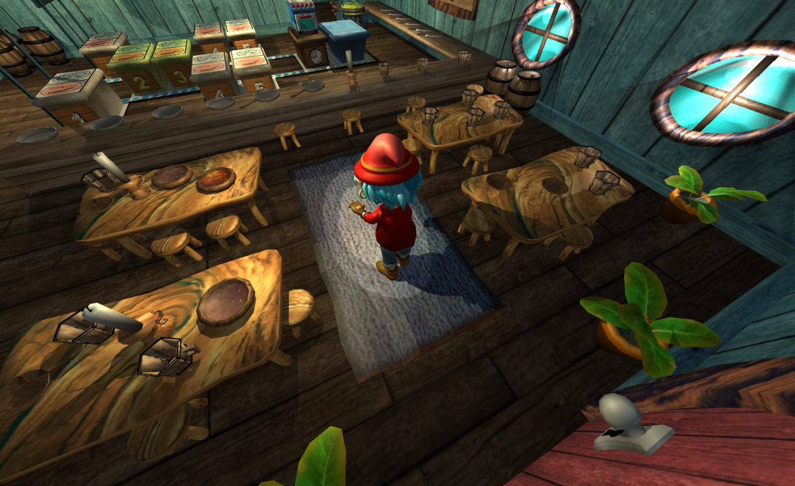
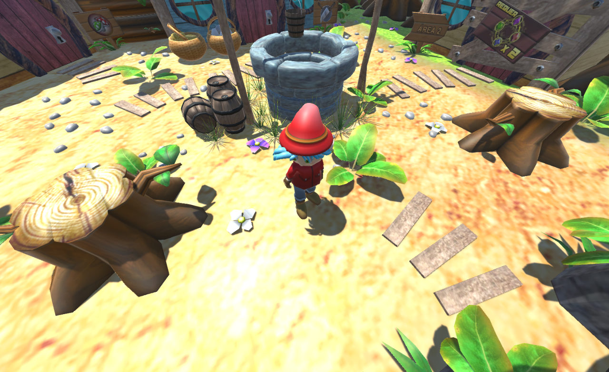
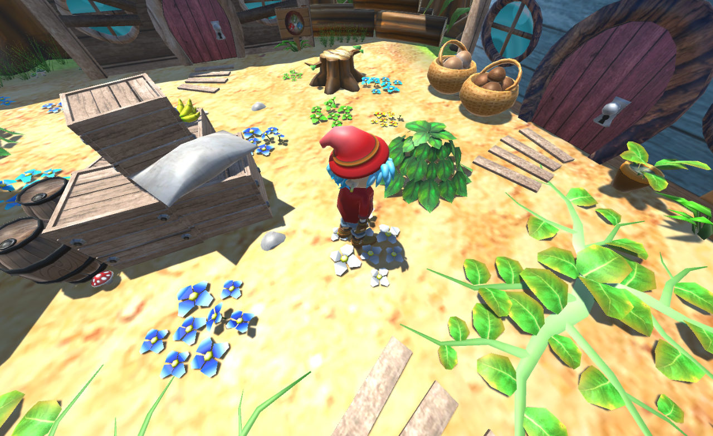
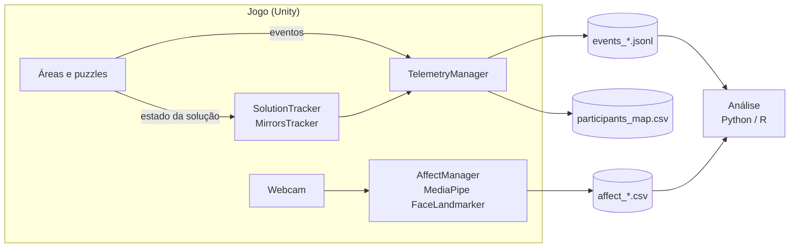

<div align="center">

# Fábulas Computacionais

**Jogo educacional 3D para o ensino de Pensamento Computacional, com coleta de dados para pesquisa em Learning Analytics.**

[](https://unity.com/releases/editor/whats-new/2021.3.31)
[](https://learn.microsoft.com/dotnet/csharp/)
[](https://github.com/homuler/MediaPipeUnityPlugin)
[](#-como-executar)
[](#-status)



</div>

---

## 📖 Sobre o projeto

**Fábulas Computacionais** é um jogo de aventura e quebra-cabeças em 3D no qual a criança explora um mundo de fantasia e resolve desafios que trabalham os pilares do **Pensamento Computacional** — sequência, repetição (laços), classificação, decomposição, algoritmos e depuração — sem precisar escrever código.

Além de ensinar, o jogo foi construído como **instrumento de pesquisa**: ele registra, de forma pseudonimizada, como cada criança joga, como monta e corrige suas soluções e, opcionalmente, suas expressões faciais pela webcam. Esses dados permitem estudar **como** as crianças raciocinam, onde têm dificuldade e como se sentem ao aprender.

### ✨ Destaques

- 🧩 **4 tipos de puzzle**, cada um com 3 fases de dificuldade crescente, distribuídos em **3 áreas exploráveis**.
- 💎 **Progressão por joias**: cada fase concluída rende uma joia, e novas áreas são liberadas com 2 e 5 joias.
- 📊 **Learning Analytics nativo**: log de eventos, estado da solução a cada tentativa, ações intermediárias e indicadores de engajamento.
- 🙂 **Captura de expressões faciais** com MediaPipe (52 blendshapes), processada localmente — **nenhuma imagem é gravada**.
- 🔒 **Privacidade desde o design**: participantes pseudonimizados, câmera desligada por padrão e indicador visível durante a captura.

---

## 🧩 Os desafios

<table>
  <tr>
    <td width="50%" valign="top">
      
      <h3>🎵 Musical — sequência e repetição</h3>
      A criança compõe uma melodia preenchendo a partitura nota a nota e usa marcadores de <b>repetição</b> para evitar reescrever trechos — uma introdução intuitiva ao conceito de <b>laço</b>.
    </td>
    <td width="50%" valign="top">
      
      <h3>🔦 Espelhos — raciocínio espacial e depuração</h3>
      Girando e empurrando pilares com espelhos e cristais, a criança precisa conduzir um feixe de luz até o alvo, testando e <b>depurando</b> a configuração a cada disparo.
    </td>
  </tr>
  <tr>
    <td width="50%" valign="top">
      
      <h3>🗂️ Conjuntos — classificação e agrupamento</h3>
      Objetos espalhados pelo cenário devem ser organizados nos espaços corretos de acordo com suas características, exercitando <b>classificação</b> e <b>abstração</b>.
    </td>
    <td width="50%" valign="top">
      
      <h3>🍲 Receitas — algoritmos passo a passo</h3>
      A criança monta uma receita escolhendo o ingrediente e a ação (cortar, fritar) de cada passo; o personagem executa a sequência — um <b>algoritmo</b> em forma de culinária.
    </td>
  </tr>
</table>

### 🌍 O mundo do jogo

<p align="center">
  
  
</p>

As **áreas externas** funcionam como mundo central: cada uma tem portas para uma fase de cada tipo de puzzle. As joias conquistadas liberam a Área 2 (2 joias) e a Área 3 (5 joias).

---

## 📊 Learning Analytics

O jogo inclui uma camada completa de coleta de dados para pesquisa, que roda **localmente** e **não altera a jogabilidade**.



| Funcionalidade | O que registra |
|---|---|
| **Sessão e perfil** | Idade, gênero, série, dispositivo e controles, com código pseudônimo por participante |
| **Navegação** | Entrada e saída de cenas; aproximação, desistência e entrada em portas |
| **Desempenho** | Início, tentativas e conclusão de cada fase; joias conquistadas |
| **Estado da solução** | O que a criança montou a cada tentativa, comparado com o gabarito e com a tentativa anterior (posições certas, distância até a solução, posições alteradas) |
| **Ações intermediárias** | Pegar e encaixar objetos, girar e empurrar pilares, montar receitas |
| **Engajamento** | Pausas, consulta à missão, reinícios, ociosidade e perda de foco |
| **Expressões faciais** | 52 blendshapes, índices derivados (sorriso, sobrancelha franzida, tensão…) e orientação da cabeça, sincronizados com os eventos |
| **Estudo e condições** | Estudo, escola, turma, máquina e condição experimental (A/B) em cada sessão |
| **Qualidade dos dados** | `id` e `seq` em cada evento, recuperação de sessões interrompidas e exportação com checksums |

### 🧑‍🔬 Para pesquisadores

- **Painel do Estudo** (no Unity): configura o estudo sem editar JSON, aponta riscos e gera **códigos de participante com etiquetas para imprimir** — nenhum nome entra no computador da escola.
- **Tela de consentimento** no jogo, com autorização separada para a câmera.
- **Painel do Pesquisador** (no jogo, `Ctrl+Shift+R`): estado da coleta, **teste da câmera** com prévia e **exportação com um clique** (`.zip` anonimizado com manifesto).
- **Pacote R [`fabulasLA`](analysis/fabulasLA)**: lê os `.zip` de todas as escolas, **valida** a coleta, monta tabelas de análise, gera o **codebook** e um **relatório completo** em HTML.
- **Testes automatizados**: 35 testes no Unity, testes do pacote R e um autoteste de ponta a ponta no jogo compilado.

Exemplo de evento registrado quando a criança testa a partitura:

```json
{"event": "solution_snapshot", "scene": "Musical 2", "data": {
  "puzzle": "Musical", "attempt": 3,
  "slots":    ["Do","Mi","Sol","Do","Mi","Sol","La",""],
  "expected": ["Do","Mi","Sol","Do","Mi","Sol","Fa","Sol"],
  "correct_positions": 6, "distance": 2, "changed_positions": [6, 7], "success": false }}
```

📄 Documentação:
- [**Guia do Pesquisador**](Assets/LearningAnalytics/Guia_do_Pesquisador.docx) — protocolo de coleta passo a passo (antes, durante e depois), com checklists e solução de problemas.
- [**Funcionalidades de Learning Analytics**](Assets/LearningAnalytics/Learning_Analytics_Fabulas_Computacionais.docx) — o que é coletado, dicionário de eventos e **24 exemplos de análises de pesquisa**.
- [Referência técnica](Assets/LearningAnalytics/README.md) e [pacote R](analysis/fabulasLA/README.md).

---

## 🚀 Como executar

### Requisitos

- **Unity 2021.3.31f1** (instale pelo [Unity Hub](https://unity.com/download): `unityhub://2021.3.31f1/3409e2af086f`)
- Windows 10/11 (64 bits)
- Webcam (opcional, apenas para a captura de expressões faciais)

### Passo a passo

1. **Clone o repositório**
   ```bash
   git clone https://github.com/rodrigolinsrodrigues/fabulas-computacionais.git
   ```

2. **Baixe o MediaPipe Unity Plugin** — o arquivo é grande (~345 MB) e por isso não fica no repositório.
   Baixe [`com.github.homuler.mediapipe-0.15.0.tgz`](https://github.com/homuler/MediaPipeUnityPlugin/releases/tag/v0.15.0)
   e coloque-o na pasta `Packages/` do projeto (ao lado de `manifest.json`).

   > A versão **0.15.0** é a última compatível com o Unity 2021.3.

3. **Abra o projeto no Unity Hub** (*Add → Add project from disk*) e aguarde a importação.
   Se for solicitado, rode **Fabulas → Learning Analytics → Configurar MediaPipe**.

4. **Jogue** abrindo a cena `Assets/Scenes/MainMenu.unity` e pressionando **Play** — ou gere uma build em *File → Build Settings → Build*.

### 🎮 Controles

| Ação | Teclado / mouse | Controle |
|---|---|---|
| Andar | `WASD` / setas | Analógico |
| Interagir | Clique esquerdo | `X` |
| Ver missão | `Q` | `Y` |
| Pausa | `Esc` | `Start` |
| Pausar câmera da pesquisa | `F9` | — |
| Painel do Pesquisador | `Ctrl+Shift+R` (+ PIN) | — |

---

## 🔬 Coleta de dados para pesquisa

A coleta é configurada pelo arquivo `Assets/StreamingAssets/research_config.json` — na build, em
`<Jogo>_Data/StreamingAssets/` —, que pode ser editado em cada computador sem recompilar o jogo:

```json
{
  "telemetryEnabled": true,
  "affectCaptureEnabled": false,
  "affectSampleRateHz": 2
}
```

Os dados são gravados em `%USERPROFILE%\AppData\LocalLow\DefaultCompany\Fabulas Computacionais\LearningAnalytics\`.
O jeito recomendado de configurar é o **Painel do Estudo** (Unity → Fabulas → Learning Analytics → Painel do Estudo),
e de recolher os dados é o botão **Exportar coleta** do Painel do Pesquisador (`Ctrl+Shift+R` no jogo).

> [!IMPORTANT]
> A captura facial vem **desligada** por padrão. Por envolver dados de crianças, ative-a apenas com aprovação
> do Comitê de Ética em Pesquisa (CEP), TCLE assinado pelos responsáveis e TALE da criança, conforme a LGPD.
> O jogo nunca grava imagens: apenas valores numéricos das expressões. O nome da criança fica somente em
> `participants_map.csv`, que deve ser guardado separadamente dos dados de análise.

---

## 🛠️ Tecnologias

| Tecnologia | Uso |
|---|---|
| [Unity 2021.3](https://unity.com/) + C# | Motor do jogo e lógica |
| [Cinemachine](https://unity.com/unity/features/editor/art-and-design/cinemachine) | Câmeras em terceira pessoa |
| [Input System](https://docs.unity3d.com/Packages/com.unity.inputsystem@1.0/manual/index.html) | Suporte a teclado e controle |
| [TextMesh Pro](https://docs.unity3d.com/Packages/com.unity.textmeshpro@3.0/manual/index.html) | Interface e textos |
| [MediaPipe Unity Plugin](https://github.com/homuler/MediaPipeUnityPlugin) (v0.15.0) | Detecção de expressões faciais (FaceLandmarker) |
| [LootLocker SDK](https://lootlocker.com/) | Serviços online (sessão de convidado) |

---

## 📁 Estrutura do repositório

```text
Assets/
├── Scenes/                  # MainMenu, áreas externas e fases de cada puzzle
├── Áreas Externas/          # GameManager, portas, contagem de joias
├── Musical/                 # Puzzle Musical (partituras, sons, scripts)
├── Receitas/                # Puzzle Receitas
├── Scripts/                 # Jogador, manipulação de objetos, lógica dos puzzles
├── DataManagers/            # Cadastro e dados por fase
├── LearningAnalytics/       # Telemetria, estado da solução, captura facial, ferramentas do pesquisador
│   ├── catalogo_eventos.json# Catálogo de eventos (fonte única do codebook e da documentação)
│   ├── Editor/              # Configuração automática do MediaPipe
│   ├── Ferramentas/Editor/  # Painel do Estudo (Unity)
│   ├── Tests/Editor/        # Testes automatizados (Unity Test Framework)
│   ├── SelfTest/            # Autoteste de ponta a ponta no jogo compilado
│   ├── SmokeTest/           # Testes rápidos da telemetria e do MediaPipe
│   └── Documentacao~/       # Geradores do Guia do Pesquisador e do documento de funcionalidades
├── StreamingAssets/         # research_config.json e modelo facial do MediaPipe
└── Tools/                   # Ferramentas de desenvolvimento (tour de capturas de tela, render de cenas)
analysis/fabulasLA/          # Pacote R: leitura, validação, tabelas, codebook e relatório
docs/images/                 # Imagens deste README
Packages/                    # Dependências (coloque aqui o .tgz do MediaPipe)
```

---

## 🚧 Status

Projeto **em desenvolvimento** e em uso em pesquisa. Próximos passos planejados incluem autorrelato afetivo
dentro do jogo, dicas sob demanda (e variações A/B do jogo) e envio automático dos dados das escolas a um servidor.

## 👥 Equipe

Desenvolvido por **Miguel** ([@MiguelxD14](https://github.com/MiguelxD14)), **Raphael Albino de Lima**,
**Laryssa Maciel**, **Hanna** e **Rodrigo Lins Rodrigues** ([@rodrigolinsrodrigues](https://github.com/rodrigolinsrodrigues)).

## 📄 Licença

Este repositório ainda não define uma licença de uso. Entre em contato com a equipe antes de reutilizar o código ou os recursos do jogo.
